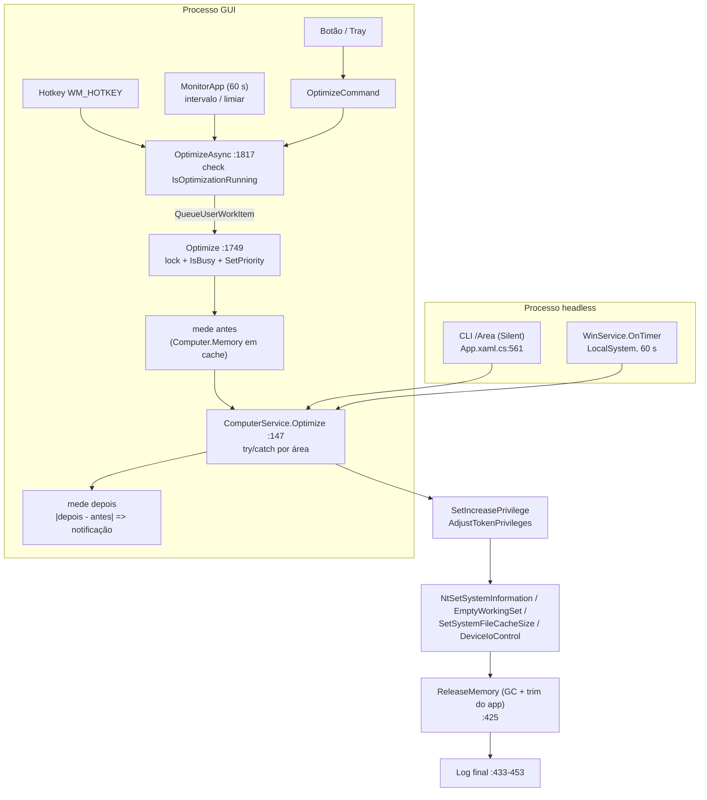

# Análise do fluxo de otimização de memória

Análise somente de leitura (nenhum código alterado). Caminhos relativos a `src/`.
Evidências marcadas com `arquivo:linha`. Itens marcados **(não verificado)** dependem de confirmação contra o SDK/WDK ou em máquina real.

## 1. Visão geral

Existem **dois processos distintos** que otimizam memória, sem nenhuma coordenação entre si:

- **GUI** (`App` + `MainViewModel`): botão, hotkey, tray, intervalo, limiar de memória. Passa por `MainViewModel.OptimizeAsync` → `Optimize` → `ComputerService.Optimize`.
- **Headless**: modo `/Service` (`WinService`, LocalSystem, timer de 60 s) e modo Silent por linha de comando (`/WorkingSet` etc.). Ambos chamam `ComputerService.Optimize` direto, sem ViewModel, sem lock, sem `IsBusy`.

Tudo converge em `Service/ComputerService.cs:147 Optimize(reason, areas)`, que roda cada área em `try/catch` próprio (falha parcial não aborta as demais) e termina com GC/trim do próprio app.

### Pontos-chave

- A orquestração da GUI tem **janela de corrida** entre o check de `IsOptimizationRunning` e a sua atribuição (otimizações duplicadas).
- O "liberado" exibido ao usuário usa **módulo** (`|depois - antes|`), então uma *queda* de memória livre aparece como "liberado".
- O retorno `NTSTATUS` das chamadas nativas é lido via `Marshal.GetLastWin32Error()`, o que **descarta o erro real**.
- O updater baixa e executa um exe elevado **sem verificação de integridade**.
- A camada nativa não é abstraída: a lógica de decisão (timer, args, updater) é testável sem admin mas **não tem nenhum teste**.

## 2. Fluxo ponta a ponta

### 2.1 Gatilhos

| Gatilho | Caminho | Observação |
|---|---|---|
| Botão Optimize | `View/Window/MainWindow.xaml:836` → `OptimizeCommand` (`ViewModel/MainViewModel.cs:57`, `CanOptimize` 274-277) → `OptimizeAsync(Manual)` | Janela inteira é `IsEnabled = !IsBusy` (`MainWindow.xaml:29`) |
| Hotkey | `MainViewModel.cs:1841-1866 RegisterOptimizationHotkey` → `HotKeyService.cs:164 Register` (`RegisterHotKey(IntPtr.Zero…)` 175); disparo `HotKeyService.cs:133 OnThreadPreprocessMessage` (WM_HOTKEY) → action 154 → `OptimizeAsync(Manual)` (`MainViewModel.cs:1850`) | Não passa por `CanExecute` |
| Tray (clique do meio / menu) | `App.xaml.cs:376-384`; `Service/NotificationService.cs:59-65` → `OptimizeCommand` | `TrayIconContextMenuControl.cs` é só visual |
| Intervalo (horas) | `MainViewModel.cs:1614 MonitorApp` (thread do pool, 60 s, 1621) → 1640-1643 → `OptimizeAsync(Schedule)` | Pula se `IsBusy` (1625); referência `_lastAutoOptimizationByInterval` (29, 138) |
| Limiar de memória | `MonitorApp` 1650-1654: `Free.Percentage < AutoOptimizationMemoryUsage` + cooldown `Constants.App.AutoOptimizationMemoryUsageInterval` → `OptimizeAsync(LowMemory)` | `MonitorComputer` (1698-1731) só atualiza a UI a cada 5 s |
| Linha de comando | `App.xaml.cs:401-438` (parse) → 561-565 (Silent) → `ComputerService.Optimize(Manual, areas)` + `Shutdown()` | Roda na thread UI; `Reason` sempre `Manual` |
| Serviço Windows | `WindowsService/WinService.cs:111-139 OnTimer` (timer 60 s, 17/33-34) → `ComputerService.Optimize(Schedule/LowMemory, …)` (123, 134) | Sem try/catch, sem guard de reentrância |

### 2.2 Diagrama

### 2.3 Área de memória → API → privilégio → versão mínima

Ordem de execução em `Optimize`: WorkingSet, SystemFileCache, ModifiedPageList, Standby, Combined, Registry, ModifiedFileCache, GC (`ComputerService.cs:162-430`).

| Área (`Enums.cs:48-59`) | API / comando | Privilégio | Versão mínima (gate no código) |
|---|---|---|---|
| WorkingSet (sem exclusões) `ComputerService.cs:752-785` | `NtSetSystemInformation(80 SystemMemoryListInformation, cmd 2 EmptyWorkingSets)` | SeProfileSingleProcess (753) | Vista+ na prática (gate XP, `OperatingSystem.cs:70`) |
| WorkingSet (com exclusões) `:718-749` | `psapi!EmptyWorkingSet(process.Handle)` por processo | SeDebug (721) | XP |
| SystemFileCache `:662-705` | `NtSetSystemInformation(21, SystemFileCacheInformation min=max=-1)` + `SetSystemFileCacheSize(-1,-1,0)` | SeIncreaseQuota (669) | XP |
| ModifiedPageList `:579-608` | `NtSetSystemInformation(80, cmd 3)` | SeProfileSingleProcess (586) | Vista |
| StandbyList / LowPriority `:627-657` | `NtSetSystemInformation(80, cmd 4 / cmd 5)` | SeProfileSingleProcess (634) | Vista |
| CombinedPageList `:459-492` | `NtSetSystemInformation(130 SystemCombinePhysicalMemoryInformation)` | SeProfileSingleProcess (466) | Win8 |
| RegistryCache `:613-621` | `NtSetSystemInformation(155 SystemRegistryReconciliationInformation)` | **nenhum habilitado** | Win8.1 |
| ModifiedFileCache `:497-574` | `CreateFile(\\.\X:)` + `DeviceIoControl(0x900F8 / 0x90054)` + `FlushFileBuffers`; só volumes Fixed | admin implícito | XP (reset write order Win7+, discard cache Win8+) |

Como o alvo é `net10.0-windows` (Win10 1607+), todos os gates de versão são verdadeiros; o código de checagem de versão é efetivamente morto (ver B-04).

### 2.4 Pré/pós, exclusões, prioridade, estado

- **Medição:** `GlobalMemoryStatusEx` (`ComputerService.cs:38`). `Free = AvailPhys` (inclui standby + livre). Baseline vem de `Computer.Memory` **em cache** (`MainViewModel.cs:1764`), não de leitura fresca.
- **"Liberado":** `MainViewModel.cs:1776-1777`, módulo da diferença. O serviço e o modo Silent não calculam nem logam o liberado, só duração por área.
- **Exclusões:** `Settings.ProcessExclusionList` só é consultada em `OptimizeWorkingSet` (`ComputerService.cs:718-749`), por nome sem `.exe`, case-insensitive. Lista vazia → chamada global do kernel (sem enumerar). Não afeta nenhuma outra área.
- **Prioridade:** `App.SetPriority` (`App.xaml.cs:773-863`) chamado em `Initialize`, 1632, 1701, 1761 e no serviço (`WinService.cs:114`).
- **Estado:** `IsOptimizationRunning` (gate de concorrência) e `IsBusy` (UI + gate dos monitores), ambos bool plano em `ViewModel/Base/ViewModel.cs:42-63`.
- **Notificações/log:** `NotificationService.Notify`; `Logger` (Event Log para `Error`; sem log em arquivo).

### 2.5 Ciclo de vida

- **Init:** `App.xaml.cs:39-48` (handlers), `Initialize` 167-190 (DI, mutex nomeado, `Migrator.Run`, `SetPriority`), `OnStartup` 393 (NotifyIcon 475, MainWindow 481, `PowerModeChanged` 493). `MainViewModel` ctor 49-90.
- **Hibernação:** `App.xaml.cs:225-285` → thread do pool → `ReinitializeAfterHibernation` (`MainViewModel.cs:1871`).
- **Shutdown:** `OnProcessExit` (292) → `Dispose` (103); `MainViewModel.Dispose` 1464-1510 (`Cancel`, `WaitOne(100)`, `CTS.Dispose`, `HotKeyService.Dispose`).
- **Cancelamento:** apenas o CTS dos loops de monitor. A otimização em curso não recebe token e não é aguardada.
- **Concorrência:** `lock(_lockObject)` só serializa dentro do processo GUI. GUI × serviço × CLI não têm exclusão mútua (o mutex de `App.xaml.cs:181` só barra segunda GUI).

## 3. Achados

Legenda: **C** crítico, **A** alto, **M** médio, **B** baixo. Nenhum achado atinge "crítico" no sentido de perda de dados; os mais graves são de segurança (updater) e corretude (hotkey, medição).

### Alto

| ID | Achado | Evidência |
|---|---|---|
| A-01 | **Updater sem verificação de integridade/assinatura.** Baixa `releases/latest/download/WinMemoryCleaner.exe` e a única validação é `FileVersion` do exe baixado == versão lida de `AssemblyInfo.cs` na branch raw. O exe roda elevado e substitui o binário executado pelo serviço LocalSystem. | `Core/Updater.cs:31-37, 47-58, 57` |
| A-02 | **Updater monta linha de `cmd /c` por concatenação**, incluindo `args` do command line sem escape (`&`, `|`, aspas) e `taskkill /f /im` que mata o serviço sem parada ordenada; se o `move` falhar, o serviço fica morto. | `Core/Updater.cs:62` |
| A-03 | **Arquivo temporário previsível** `%TEMP%\WinMemoryCleaner.exe` (em `C:\Windows\Temp` quando SYSTEM), sem `FileShare.None`/ACL e com janela TOCTOU entre checagem de versão e `move`. | `Core/Updater.cs:43-45, 52-62` |
| A-04 | **"Liberado" enganoso:** `Free > antes ? Free - antes : antes - Free`. Se a memória livre cair (outro processo alocou), a notificação mostra valor positivo como "liberado". Baseline vem do cache (até 5 s defasado, e o monitor é pulado durante `IsBusy`). | `ViewModel/MainViewModel.cs:1764-1777` |
| A-05 | **Erro nativo perdido:** `NtSetSystemInformation` devolve NTSTATUS, mas o código usa `Marshal.GetLastWin32Error()`; Nt* não define last-error Win32, então o valor é lixo (frequentemente 0 ou 1300 deixado por `AdjustTokenPrivileges`). Mensagens de falha ficam erradas ou "operação concluída com êxito". | `Service/ComputerService.cs:477, 593, 619, 642, 685, 760`; `Interop/NativeMethods.cs:74-75` |
| A-06 | **Hotkey para de funcionar após hibernação:** `RegisterHotKey(IntPtr.Zero…)` associa o atalho à thread chamadora; `ReinitializeAfterHibernation` roda em thread do pool sem message pump, então `WM_HOTKEY` nunca chega ao handler da UI. Além disso `_registered` (Dictionary) é mutado por duas threads sem lock. | `Service/HotKeyService.cs:175`; `App.xaml.cs:232`; `MainViewModel.cs:1880` |
| A-07 | **Otimizações sobrepostas (check-then-act não atômico):** `OptimizeAsync` checa `IsOptimizationRunning` (1821) mas o flag só é setado dentro da thread enfileirada, após o lock (1751-1756). Hotkey + botão + timer no mesmo instante enfileiram duas otimizações em sequência. Hotkey e serviço nem checam `CanOptimize`/`IsBusy`. | `MainViewModel.cs:1817-1828, 1749-1756`; `HotKeyService.cs:154` |
| A-08 | **Exceção não tratada na thread do pool derruba o processo:** `Optimize` é `try/finally` sem `catch`, via `QueueUserWorkItem`; qualquer falha em `Memory`, `string.Format`, `Notify` ou `Application.Current` nulo (1795) vira unhandled. | `MainViewModel.cs:1749-1809, 1828`; `App.xaml.cs:591` |
| A-09 | **`WinService.OnTimer` sem try/catch nem guard de reentrância:** timer em thread do pool; otimização > 60 s sobrepõe a seguinte; exceção em `Elapsed` derruba o serviço; `OnStop` não aguarda a otimização em curso. | `WindowsService/WinService.cs:93-104, 111-139` |
| A-10 | **Possível deadlock no tray:** `NotificationService.Update` segura `_disposeLock` e faz `Dispatcher.Invoke` síncrono; `OnRotationTimerTick` (UI) pede o mesmo lock. Update vindo do pool durante otimização pode travar. | `Service/NotificationService.cs:524, 575, 613, 635`; `MainViewModel.cs:1718, 1758, 1791` |

### Médio

| ID | Achado | Evidência |
|---|---|---|
| M-01 | `AdjustTokenPrivileges` só testa o bool; retorna TRUE com `ERROR_NOT_ALL_ASSIGNED (1300)`. "Privilégio ok" falso; a falha só aparece depois na chamada Nt. | `ComputerService.cs:128-131` |
| M-02 | **RegistryCache sem `SetIncreasePrivilege`**: depende de ordem (outra área ter habilitado antes). Isolada, provavelmente falha (a confirmar). | `ComputerService.cs:613-621` |
| M-03 | **ModifiedFileCache loga sucesso sem ter feito nada** quando o handle do volume é inválido (`continue` silencioso); falha de `DeviceIoControl` é engolida sem log; falha de `FlushFileBuffers` num volume aborta os demais. Códigos IOCTL 0x900F8/0x90054 **não validados** contra o SDK. | `ComputerService.cs:510-511, 541-544, 563-566, 570-571`; `Core/Constants.cs:87-88` |
| M-04 | **Standby + StandbyLowPriority ligados:** só o low priority roda; o purge completo é pulado. | `ComputerService.cs:272, 285` |
| M-05 | `MemoryCombineInformationEx.Flags` é `long` (nativo ULONG): mismatch de tamanho em x86. **`SystemFileCacheInformation64` = 72 bytes** com `Pack=1` (nativo x64 = 64 bytes **(não verificado)**); se houver `STATUS_INFO_LENGTH_MISMATCH`, a exceção em 686 impede `SetSystemFileCacheSize` (703). | `Core/Structs.cs:18-24, 79-91`; `ComputerService.cs:686, 703` |
| M-06 | **`IsBusy` é bool plano compartilhado**: setters de configuração fazem `IsBusy=true…false` e podem zerar o `IsBusy` da otimização; `MainWindow.xaml.cs:208` força `false`. O setter chama `Dispatcher.Invoke` síncrono, inclusive dentro do `lock` de `Optimize`. | `ViewModel/Base/ViewModel.cs:42-63`; `MainWindow.xaml.cs:208` |
| M-07 | `Settings.ProcessExclusionList` (`SortedSet`) mutado na UI e enumerado no pool: risco de `InvalidOperationException`/lista inconsistente. | `MainViewModel.cs:1588, 1911`; `ComputerService.cs:718, 724` |
| M-08 | **Falhas por área engolidas** e "MemoryOptimized" exibido mesmo com áreas falhas; `Optimize` é `void`, o chamador não sabe do erro. Erros dos monitores vão para `Logger.Debug` (invisível em Release). | `ComputerService.cs:403-413, 433-453`; `MainViewModel.cs:1664, 1728`; `App.xaml.cs:42` |
| M-09 | `NotifyIcon` (Visible/Icon/Text/ShowBalloonTip) manipulado direto de threads do pool, sem marshalling (só `Loading` faz). | `NotificationService.cs:506-509, 642-647` |
| M-10 | **Escalada local via instalação do serviço:** `sc create` com o `ProcessPath` do exe portable (Downloads/Desktop) como LocalSystem; sem checar diretório/ACL do binário. Substituir o exe = SYSTEM no próximo boot. Aspas no `binPath` mitigam só o unquoted path. | `WinServiceInstaller.cs:16-45` |
| M-11 | **`Updater.Update` roda também em `/Service` e `/Install`**, antes do dispatch; serviço LocalSystem faz download e substituição sem consentimento por execução. A lógica de gate em `Updater.cs:112` é confusa. | `App.xaml.cs:408`; `Core/Updater.cs:112` |
| M-12 | **Settings em HKLM** confiadas pelo serviço sem validação de faixa; `Settings.Reset`/`Migrator` apagam subkeys sem confirmação. Superfície depende da ACL herdada de HKLM\SOFTWARE. | `Settings.cs:134-259`; `Migrator.cs:143, 201-212` |
| M-13 | `Uninstall` mata `mmc`, `procexp`, `procexp64`, `taskmgr` do sistema inteiro; `Reset` mata todo processo de mesmo nome. Invasivo e não opcional. | `WinServiceInstaller.cs:56-58`; `App.xaml.cs:518-531` |
| M-14 | `Dispose` do ViewModel: após `CTS.Dispose()` os loops ainda avaliam `.Token` fora do try (`ObjectDisposedException` no pool); não aguarda a otimização em curso. | `MainViewModel.cs:1481-1490, 1616, 1703` |
| M-15 | `RegisterOptimizationHotkey` muta `Settings.OptimizationKey/Modifiers` antes de validar e deixa estado inconsistente se falhar; `Register` adiciona em `_registered` mesmo com `result == false`. | `MainViewModel.cs:1843-1859`; `HotKeyService.cs:177-178` |
| M-16 | `MonitorApp` marca o timestamp ao agendar, não ao concluir: otimização que falha consome o ciclo. No serviço, `_lastAutoOptimization*` começa em `Now`, então intervalo longo nunca dispara se o serviço reinicia antes. | `MainViewModel.cs:1643-1656`; `WinService.cs:15-16` |

### Baixo

| ID | Achado | Evidência |
|---|---|---|
| B-01 | Parse de args frouxo: `Replace("-", "/")` corrompe qualquer arg com hífen; `Enum.TryParse` aceita inteiros e listas por vírgula (valores indefinidos); "último vence" entre `/Install` e `/Uninstall`. | `App.xaml.cs:401-436` |
| B-02 | `HttpClient` sem limite de bytes; regex de versão em branch raw sem pin de commit/tag. | `Updater.cs:18, 32, 47-53` |
| B-03 | `app.manifest` com `requireAdministrator` fixo (inclusive para `/Reset`), `supportedOS` herdado de Vista/7/8, sem `PerMonitorV2`. | `app.manifest:26` |
| B-04 | `Major >= 6.2` / `6.3` (int × double) é falso para Win8/8.1; bitness do SO em vez do processo (WOW64); código morto no alvo atual. | `ComputerService.cs:65-70, 678` |
| B-05 | Mensagem de erro cita `SeDebugName` mas o privilégio checado é `SeProfSingleProcessName`; `e is not null` sempre true; buffer `AllocHGlobal(1)` não inicializado. | `ComputerService.cs:754, 764, 519-538` |
| B-06 | Privilégios habilitados nunca revertidos; `GlobalMemoryStatusEx` com falha devolve zeros em vez do valor anterior. | `ComputerService.cs:132, 38-41` |
| B-07 | `SetPriority` roda em thread do pool, `Process.GetCurrentProcess()` não é descartado e é chamado a cada 60 s. | `App.xaml.cs:809, 818` |
| B-08 | `Thread.Sleep(1000)` na thread UI antes do shutdown; handlers nunca removidos (lambda inline); `NotificationService.Initialize` recria o menu sem descartar o anterior; `Process.GetProcesses()` sem `Dispose`. | `MainWindow.xaml.cs:43-47, 202`; `NotificationService.cs:56`; `MainViewModel.cs:821`; `ComputerService.cs:724` |
| B-09 | Progresso aproximado (popcount de `MemoryAreas`+1) pode não bater com os passos emitidos; 3 propriedades setadas de forma não atômica. | `MainViewModel.cs:1738-1743, 1826` |
| B-10 | `Reason` sempre `Manual` para hotkey/tray/botão/CLI: log não distingue origem. | `App.xaml.cs:563`; `MainViewModel.cs:1850` |

## 4. Custo e efeito colateral por área

| Área | Custo / efeito | Frequência mínima segura (estimativa, não medida) |
|---|---|---|
| WorkingSet | Barato em CPU; move páginas para standby/modified; causa soft faults ao reabrir apps e picos de latência. Trimar o próprio app/UI gera faults imediatos. | Evitar em loop curto; ≥ 30 min no automático |
| SystemFileCache | Esvazia o cache de arquivos do sistema: mais leituras de disco. | Só sob pressão real |
| ModifiedPageList | Rajada de escrita no pagefile; páginas vão para standby (não vira "livre" de imediato). | Sob demanda |
| StandbyList | Libera RAM "livre" mas destrói cache/prefetch: re-leituras. Melhora o número, pode piorar a responsividade. | Só com limiar de pouca memória |
| StandbyLowPriority | Menos agressivo que StandbyList. | Preferível ao purge completo |
| CombinedPageList | Dedup intensivo em CPU, ganho incerto. | Raro/opt-in |
| RegistryCache | Custo baixo, ganho baixo. | Livre |
| ModifiedFileCache | Flush de volumes: rajada de escrita, possível bloqueio breve de I/O. | Sob demanda |

Efeito sistêmico: o app **mede sucesso por `AvailPhys`**, que sobe ao purgar standby, mas isso não é ganho de desempenho. O limiar `LowMemory` baseado em `Free.Percentage` (que inclui standby) tende a ser pouco informativo no Windows moderno; avaliar "available" + pressão de commit.

## 5. Cobertura de testes

**Existe:** constantes de args (`CoreTests.cs:39-59`), Settings (`IntegrationTests.cs:96-141`, grava HKLM de verdade), `ComputerService` com `Optimize(None)` e eventos (`ServiceTests.cs:27-88`), otimização real com todas as áreas sem assert de efeito (`IntegrationTests.cs:25-96, 604`, exige admin), `CanOptimize` (`ViewModelTests.cs:242-254, 525-537, 640`). `Mocker.cs` só constrói dados, sem fakes de serviço.

**Zero testes** (grep por `WinService`/`Updater`/`Migrator`/`Installer`/`OnStartup`): `WinService`, `WinServiceInstaller`, `Updater`, `Migrator`, parsing de args, `Helper.GetExecutablePath`/`DeleteFile`.

**Testável sem admin e hoje não testado (extração pequena):**

1. `ParseArgs(string[]) → (StartupType, Areas, flags)` puro (hífen/barra, case, `Install+Uninstall`, enum numérico, desconhecidos).
2. Predicado `ShouldOptimize(now, lastInterval, lastMem, settings, freePct)` com relógio injetável (decisão do `OnTimer` e do `MonitorApp`).
3. Updater: montagem da linha de comando, comparação de versão, regex de `AssemblyInfo`.
4. Cálculo do "liberado" (função pura sobre dois snapshots).
5. `Migrator.CleanupOrphanedOldUpdateFiles` com diretório injetável.
6. Argumentos do `sc` em `WinServiceInstaller` (retornar a lista antes de executar).

**Exige abstração da camada nativa:** `INativeMemory`/`IPrivilegeProvider` (testar agregação de falhas por área sem admin), `IServiceControl`, `ISettingsStore`, `IProcessLauncher`, `IHttpDownloader`, `IClock`. Hoje `ComputerService` instancia tudo direto e `DependencyInjection.Container` é estático.

## 6. Melhorias e features

Impacto (I), esforço (E), risco (R): B/M/A. "Test." = testável sem admin.

### 6.1 Melhorias técnicas

| # | Item | I | E | R | Test. |
|---|---|---|---|---|---|
| T-01 | Corrigir "liberado": leitura fresca antes/depois, mostrar delta com sinal (ou "variação"), sem módulo (A-04) | A | B | B | sim (função pura) |
| T-02 | Ler NTSTATUS retornado e converter via `RtlNtStatusToDosError`; checar 1300 em `AdjustTokenPrivileges` (A-05, M-01) | A | B | B | parcial |
| T-03 | Guard atômico (`Interlocked.CompareExchange`) em `OptimizeAsync` + `try/catch` em `Optimize` (A-07, A-08) | A | B | B | sim |
| T-04 | Registrar hotkey na thread da UI (`Dispatcher.Invoke`) e lock em `_registered` (A-06, M-15) | A | B | M | parcial |
| T-05 | `OnTimer`: try/catch, `Interlocked` anti-reentrância, `OnStop` aguarda; serviço usa o mesmo `ShouldOptimize` (A-09) | A | B | B | sim com `IClock` |
| T-06 | **Relatório por área** (`OptimizationResult { Area, Status, NtStatus, Elapsed, Error }`) retornado por `Optimize` em vez de `void`; UI/serviço mostram sucesso parcial (M-08, M-03) | A | M | B | sim |
| T-07 | Updater: SHA-256 publicado (arquivo `.sha256` na release) ou Authenticode; trocar `cmd /c` por processo auxiliar com `ArgumentList`; temp com `FileShare.None` em diretório próprio (A-01..A-03) | A | M | M | parcial |
| T-08 | Corrigir structs (`Flags` ULONG; validar tamanho de `SystemFileCacheInformation64` contra WDK) e `RegistryCache` com privilégio (M-02, M-05) | M | B | M | só em máquina real |
| T-09 | Abstrair camada nativa (`INativeMemory`, `IClock`, `ISettingsStore`) para testes com fake | A | A | M | sim (é o habilitador) |
| T-10 | Extrair `ParseArgs`/`ShouldOptimize`/montagem do `sc` e testar (seção 5) | M | B | B | sim |
| T-11 | Validar diretório do binário no `/Install` (exigir `%ProgramFiles%` ou ACL restrita) (M-10) | M | B | M | parcial |
| T-12 | `Reason` distinto por origem (Hotkey/Tray/Button/Cli/Service) (B-10) | B | B | B | sim |
| T-13 | Log em arquivo local rotativo (hoje só Event Log) para diagnóstico | M | B | B | sim |

### 6.2 Features candidatas

| # | Feature | I | E | R | Test. |
|---|---|---|---|---|---|
| F-01 | **Modo dry-run/relatório**: mostra o que seria feito e o estado das áreas sem executar | M | B | B | sim |
| F-02 | **Condicionar a ociosidade/sessão bloqueada/bateria** (`GetLastInputInfo`, `SystemEvents.SessionSwitch`, `SystemParametersInfo`/`PowerStatus`) | A | M | B | sim com fake |
| F-03 | **Estatísticas históricas** (JSON local: data, reason, áreas, delta, duração) + gráfico simples | M | M | B | sim |
| F-04 | **Perfis** (ex.: "leve", "agressivo") mapeando conjuntos de `MemoryAreas` e gatilhos | M | M | B | sim |
| F-05 | **Exclusão por caminho/padrão** além de nome (e proteção de processos críticos por padrão) | M | M | B | sim |
| F-06 | **Cooldown/backoff adaptativo**: dobra o intervalo se o ganho medido for ~0 | M | M | B | sim |
| F-07 | Limiar baseado em *available* + commit charge em vez de `Free%` | M | M | M | sim |
| F-08 | Alerta (toast) quando áreas falham repetidamente | B | B | B | sim |
| F-09 | Agendamento por horário/dias (além de intervalo em horas) | B | M | B | sim |

### 6.3 O que NÃO vale fazer

- **Migrar `DllImport` → `LibraryImport`** ou habilitar `Nullable`: decisão já tomada; ganho irrisório.
- **Otimizar em intervalos curtos / loop agressivo**: purgar standby sob demanda piora responsividade; o número "livre" sobe mas o sistema fica mais lento.
- **CombinedPageList por padrão**: CPU alto, ganho incerto; manter opt-in.
- **Reimplementar o serviço como processo separado complexo** (IPC, pipe): para uso pessoal, uma exclusão mútua simples (mutex global nomeado) resolve GUI × serviço × CLI.
- **Fingir "sucesso" da otimização via número de memória livre** como métrica de saúde: sem baseline de latência/page faults, é métrica de vaidade.
- **Preservar compatibilidade com o upstream**: sem PR previsto, não limita nenhuma das mudanças acima.

## 7. Roadmap sugerido

| Fase | Foco | Itens |
|---|---|---|
| 1 — Correções de baixo risco | Corretude e crash | T-01, T-02, T-03, T-05 (parte try/catch), T-04, T-12 |
| 2 — Testabilidade | Habilitar testes sem admin | T-10, T-09, T-06 (relatório por área), testes de `ParseArgs`/`ShouldOptimize`/liberado |
| 3 — Segurança | Updater e serviço | T-07, T-11, M-11 (opt-out de update no serviço), M-13 (confirmação/escopo dos kills) |
| 4 — Robustez nativa | Interop | T-08, M-03, M-04, M-16 |
| 5 — Features | Valor ao usuário | F-02, F-06, F-03, F-01, F-04, F-05 |

## 8. Decisões pendentes (do dono do projeto)

1. **Mutex global GUI × serviço × CLI:** bloquear a segunda otimização (recomendado) ou permitir sobreposição?
2. **Updater:** adotar hash SHA-256 publicado na release (exige mudar o CI) ou Authenticode (exige certificado)? Ou desativar autoupdate no serviço?
3. **`/Install`:** exigir binário em `%ProgramFiles%` (muda o uso "portable") ou apenas avisar?
4. **Kill de `mmc/procexp/taskmgr` no uninstall e kill por nome no `/Reset`:** remover, tornar opcional, ou manter?
5. **Semântica do "liberado":** mostrar delta com sinal ("variação") ou manter só valores positivos?
6. **Standby + LowPriority ligados:** executar ambos (purge completo) ou manter só o low priority?
7. **Escopo de features** da seção 6.2: quais entram (sugestão: F-02, F-06, F-03).
8. **Abstração da camada nativa (T-09):** aceitar o custo de refactor para destravar testes?

## 9. Decisões tomadas e status de implementação

Decisões (delegadas pelo dono do projeto) e o que foi implementado nos commits `1432aa8` e `612b50b`. Build com 0 warnings e 350 testes verdes (340 anteriores + 10 novos).

| # | Decisão | Status |
|---|---|---|
| 1 | Bloquear otimização concorrente: mutex global `Global\<AppId>.Optimize` em `ComputerService.Optimize` (vale para GUI, serviço e CLI; falha aberta se o mutex não puder ser criado) + guard atômico `Interlocked` em `OptimizeAsync` | feito (A-07, A-09) |
| 2 | Updater: SHA-256 conferido contra o `checksums.txt` já publicado na release (falha fechada, sem mudar o CI); diretório temporário exclusivo; argumentos sanitizados; `net stop/start` do serviço em vez de matar sem parada; update só no modo GUI; condição de `AutoUpdate` corrigida (estava invertida) | feito (A-01..A-03, M-11) |
| 3 | `/Install` apenas avisa (log) quando o exe está fora de `Program Files`/`Windows` | feito (M-10) |
| 4 | Removidos os kills de `mmc/procexp/procexp64/taskmgr` no uninstall; o kill de outras instâncias do próprio exe no `/Reset` foi mantido (necessário) | feito (M-13, parcial) |
| 5 | "Liberado" nunca negativo: delta com clamp em zero e baseline com leitura fresca | feito (A-04) |
| 6 | Standby + LowPriority ligados: executa o purge completo | feito (M-04) |
| 7 | Features da seção 6.2 | adiadas (nenhuma implementada) |
| 8 | Abstração completa da camada nativa | adiada; só extração de funções puras onde barato (`TryGetExpectedHash`, `BuildForwardedArguments`) |

### Itens corrigidos

A-01, A-02, A-03, A-04, A-05 (NTSTATUS convertido via `RtlNtStatusToDosError` em um wrapper, sem tocar nos call sites), A-06 (registro do hotkey despachado à thread da UI + `_registered` só guarda registro bem-sucedido), A-07, A-08 (`catch` + `?.` em `Optimize`), A-09 (try/catch, anti-reentrância e `OnStop` aguardando), M-01 (erro 1300), M-02 (privilégio no RegistryCache), M-03 (volumes: falha em um não aborta os demais, erros agregados), M-04, M-11, B-04 (comparação de versão), B-05 (mensagem do privilégio).

### Pendente / não alterado

- **A-10** (deadlock potencial no tray), **M-06** (`IsBusy` compartilhado), **M-07** (lista de exclusão sem sincronização), **M-08** (aviso ao usuário de falha parcial), **M-09** (NotifyIcon fora da UI): exigem mexer no `NotificationService` e no modelo de `IsBusy`; sem como validar sem rodar a UI com admin.
- **M-05** (tamanho das structs): não alterado. Com `Pack = 1`, trocar `Flags` para `uint` reduziria `MemoryCombineInformationEx` a 20 bytes e quebraria o x64 que hoje coincide com os 24 nativos; o tamanho de `SystemFileCacheInformation64` precisa ser validado contra o WDK em máquina real.
- **M-12, M-14, M-15, M-16** e a maioria dos baixos.
- **Efeito colateral do `net start`:** se o serviço estava instalado mas parado de propósito, o update o inicia.
- Funções puras para `ParseArgs`/`ShouldOptimize` (seção 5, itens 1-2) e features F-xx seguem como roadmap.
